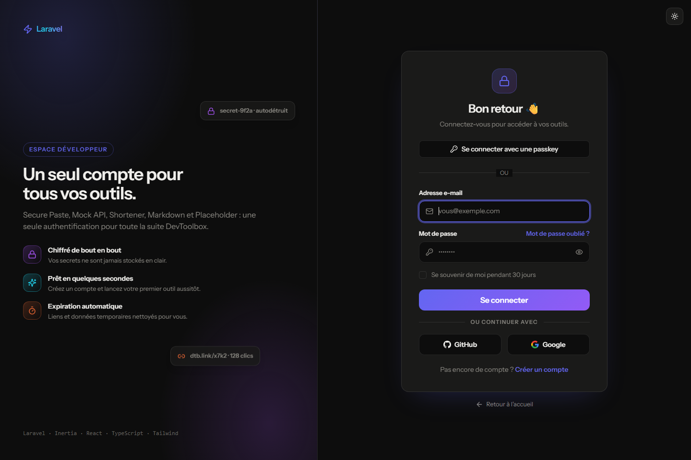
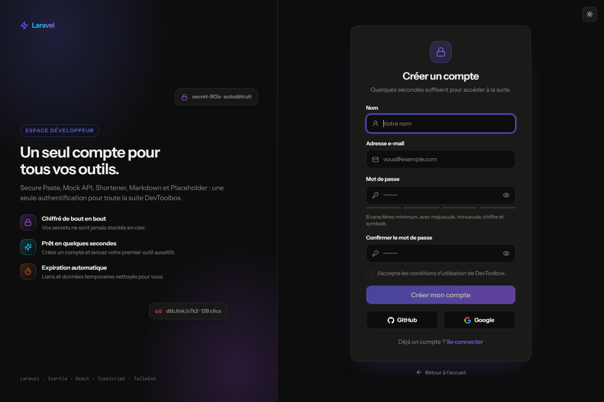
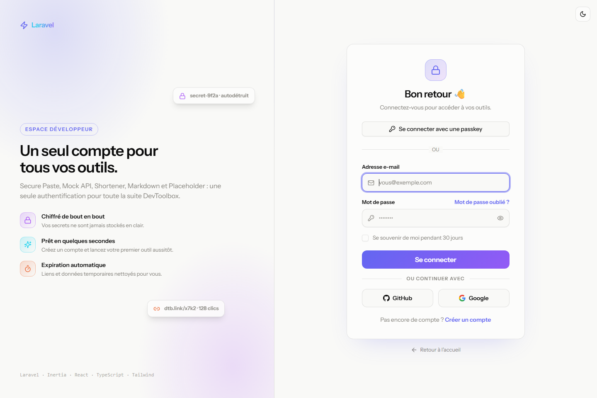
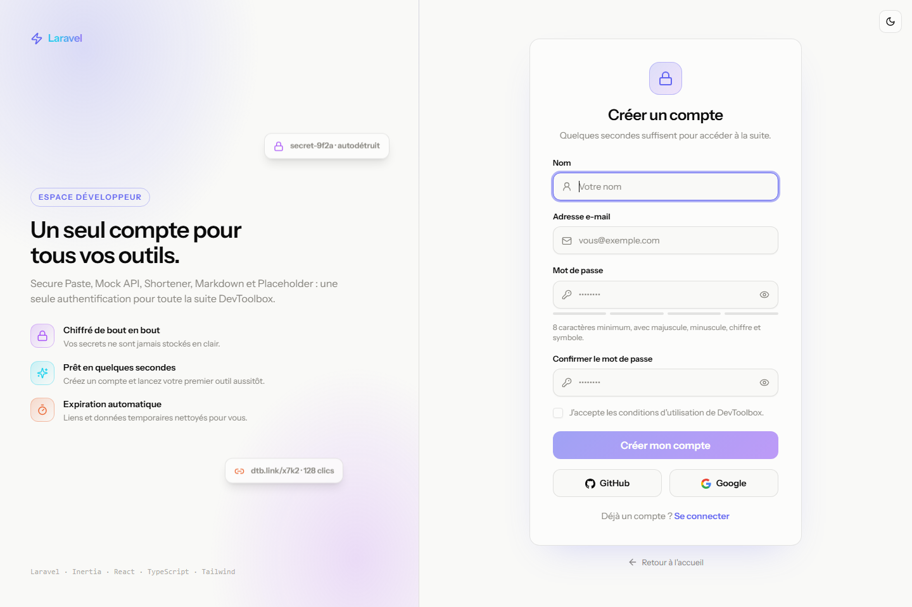
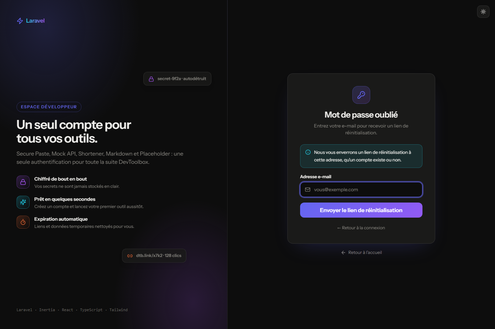
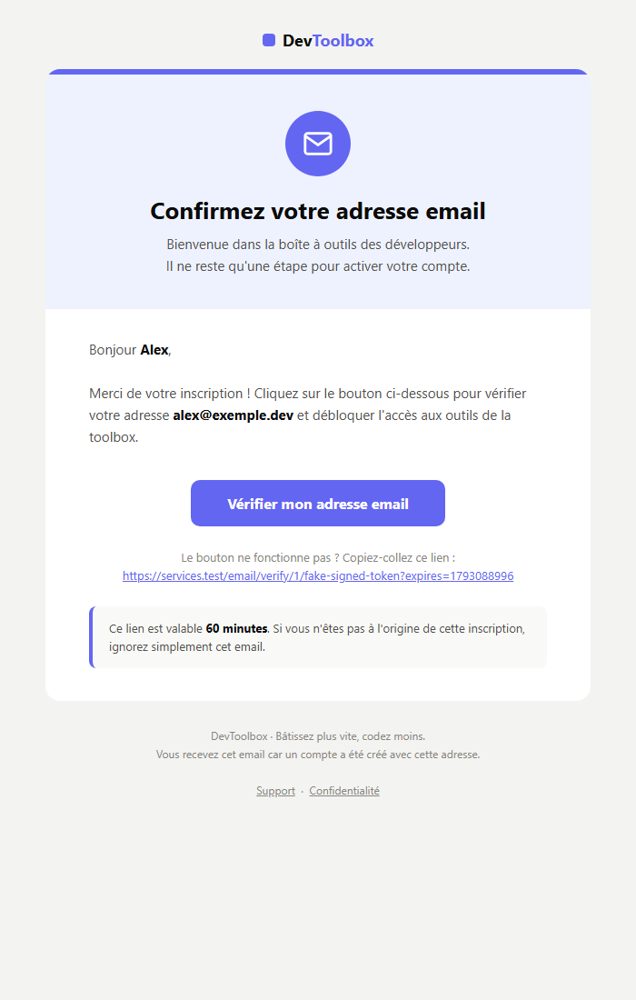
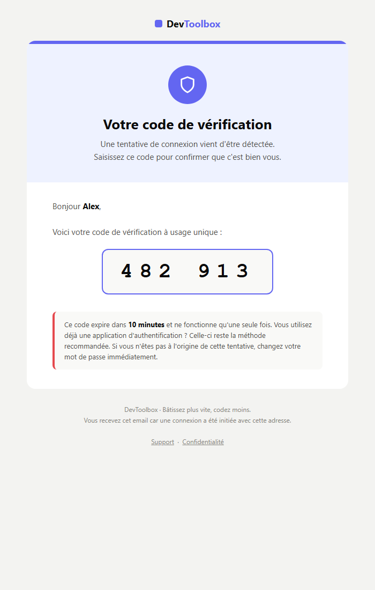
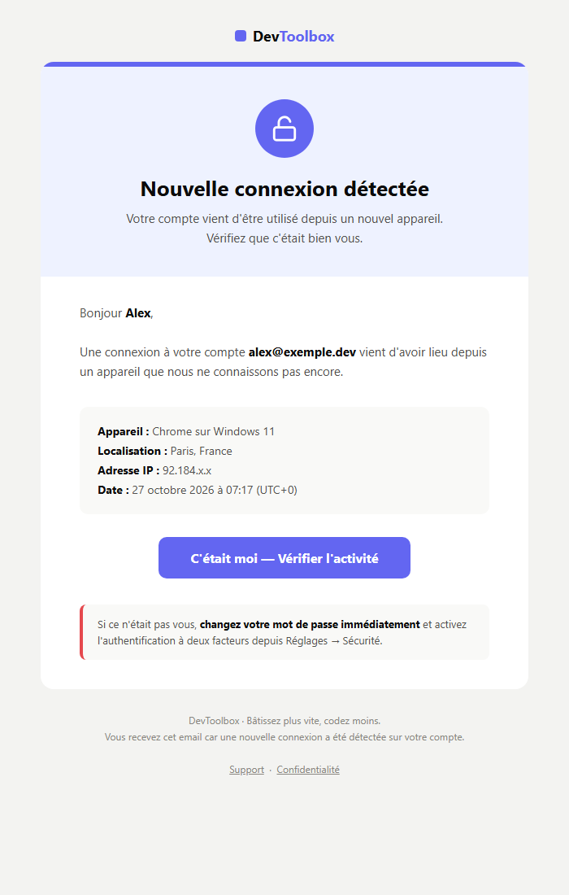

<div align="center">

# DevToolbox

**Une boîte à outils complète pour les développeurs, réunie dans une seule application.**

Partage de secrets, mock d'API, raccourcisseur de liens, éditeur Markdown, générateur d'images —
cinq micro-services, un monolithe modulaire, une expérience fluide.

[ 🌐 ainatrix.com ](https://ainatrix.com) · [ 📦 Dépôt Git ](https://github.com/ainapappy/services.git)

</div>

---

## Pourquoi DevToolbox ?

Les développeurs utilisent chaque jour une dizaine d'outils dispersés : un site pour partager un secret, un autre pour simuler une API, un troisième pour raccourcir un lien. **DevToolbox réunit ces essentiels dans une application unique, rapide et élégante.**

C'est aussi une démonstration d'ingénierie : un monolithe **modulaire** où chaque outil vit dans son propre espace, avec son contrôleur, ses pages et ses tables — sans la complexité d'une architecture distribuée, avec toute la propreté d'un code séparé.

## Les 5 outils

| Outil                  | Ce qu'il fait                                                                             | Points techniques                                                                               |
| ---------------------- | ----------------------------------------------------------------------------------------- | ----------------------------------------------------------------------------------------------- |
| **Secure Paste**       | Partage un texte confidentiel via un lien qui s'autodétruit (après lecture ou expiration) | Hash signé, suppression après lecture, purge planifiée (scheduler)                              |
| **JSON Mock API**      | Transforme un objet JSON en endpoint public instantané pour tester un frontend            | Cast Eloquent `json`, réponse `application/json` sur mesure, cache write-through                |
| **URL Shortener**      | Raccourcit des liens et mesure chaque clic : navigateurs, pays, tendance 7 jours          | Relation One-to-Many, tracking asynchrone (files d'attente), agrégats SQL, redirection en cache |
| **Markdown Previewer** | Édite du Markdown avec rendu HTML temps réel, partageable et exportable                   | Parsing CommonMark, debounce côté client, double barrière anti-XSS (serveur + DOMPurify)        |
| **SVG Placeholder**    | Génère des images de remplacement à la volée depuis une URL paramétrée                    | Routes contraintes par regex, whitelist de couleurs, cache HTTP + `304 Not Modified`            |

## Stack technique

| Domaine  | Choix                                                      |
| -------- | ---------------------------------------------------------- |
| Backend  | **Laravel 13** — monolithe modulaire                       |
| Frontend | **React 19 + TypeScript** via **Inertia.js v3**            |
| Styling  | **Tailwind CSS v4** + composants **Radix UI**              |
| Routes   | **Wayfinder** — fonctions typées générées, zéro URL en dur |
| Auth     | **Fortify**                                                |
| Qualité  | **Pest**, **PHPStan (Larastan)**, **Pint** (PSR-12)        |
| Build    | **Vite** (vite-plus)                                       |

## Points d'architecture

- **Modularité maîtrisée** — chaque outil est isolé : `app/Http/Controllers/Tools/`, `resources/js/pages/tools/`, une table dédiée par fonctionnalité. Ajouter un sixième outil ne touche jamais les cinq premiers.
- **Performance par défaut** — cache sur les hot paths (redirections, endpoints mock, images générées), tracking des clics en file d'attente, agrégations 100 % SQL.
- **Sécurité systématique** — `FormRequest` sur chaque entrée utilisateur, échappement systématique des contenus (XSS), rate limiting sur les endpoints publics, rien d'exposable en séquentiel.
- **TypeScript strict** — props de pages Inertia typées (`PageProps`), types partagés serveur ↔ client, `any` banni.
- **UX soignée** — thème sombre/clair persistant, transitions Inertia fluides, animations respectant `prefers-reduced-motion`, accessibilité clavier.

## Tests & qualité

- **Suite complète** : `composer test` (Pint + PHPStan/Larastan niveau 7 + Pest) — 100+ tests couvrant le parcours nominal et les cas d'erreur de chaque outil et de chaque flux auth.
- **Parcours vérifiés** : lecture unique destructrice (Secure Paste), service du cache (Mock API, redirections, placeholders), tracking asynchrone (job `TrackClick`), purge planifiée (`pastes:prune`, scheduler horaire), neutralisation XSS (Markdown serveur + client, échappement SVG), réponses `304 Not Modified`.
- **Garde-fous en développement** : `Model::preventLazyLoading()` pour détecter les N+1 immédiatement, commandes destructives interdites en production, rate limiting sur tous les endpoints publics d'écriture.

## Authentification

Auth complète sur Fortify, intégrée aux maquettes de [`.knowledge/design/`](./.knowledge/design/) :

- **Connexion & inscription** — throttling natif Fortify (5 tentatives/min), case « Se souvenir de moi », jauge de force du mot de passe alignée front ↔ serveur (`Password::defaults()` : 8 caractères, casse mixte, chiffre, symbole).
- **Mot de passe oublié** — réponse neutre anti-énumération, rate limit dédié (3/min/IP), e-mail markdown DevToolbox avec expiration affichée, invalidation des autres sessions après reset.
- **Vérification e-mail** — outils bloqués pour les comptes connectés non vérifiés (les invités restent acceptés), cooldown « Renvoyer » doublé côté serveur (1/min/utilisateur), e-mail markdown signé.
- **2FA (TOTP)** — activation dans _Réglages → Sécurité_ (confirmation de mot de passe requise), défi avec codes de récupération à usage unique et « appareil de confiance » (cookie 30 jours qui court-circuite le défi).
- **Connexion sociale** — GitHub & Google via Socialite, fusion par e-mail **uniquement si l'adresse locale est vérifiée** (anti-takeover), annulation OAuth gérée proprement, gestion des liaisons dans le profil.

### Captures (sombre / clair)

| Connexion                                          | Inscription                                             |
| -------------------------------------------------- | ------------------------------------------------------- |
|   |   |
|  |  |



### Emails transactionnels

Socle Blade 100 % tables/inline (600 px, dark mode basique), icônes héros en PNG hébergés, Mailables en file d'attente avec quota (5 emails auth/heure/utilisateur) — previews sur `/dev/mails` en local.

| Vérification                                          | Code 2FA                                             | Nouvelle connexion                                       |
| ----------------------------------------------------- | ---------------------------------------------------- | -------------------------------------------------------- |
|  |  |  |

Branchés sur les flux : vérification d'adresse et reset (notifications Fortify personnalisées), **bienvenue** après vérification (idempotent), **alerte nouvelle connexion** uniquement sur appareil inconnu (empreinte IP + user-agent), **confirmation de changement de mot de passe** (reset + profil), et **code 2FA par e-mail** — repli du TOTP, code à 6 chiffres à usage unique, hashé en cache, expiration 10 minutes, throttlé.

## Design

Le design system complet (tokens, composants, animations) est documenté dans [`.knowledge/design/`](./.knowledge/design/) — ouvrir `index.html` via `file://` pour parcourir les maquettes des 5 outils (thème sombre/clair inclus).

## Démarrage rapide

```bash
# 1. Dépendances
composer install
npm install

# 2. Environnement
cp .env.example .env
php artisan key:generate
php artisan migrate

# 3. Développement
composer dev        # serveur Laravel + Vite en parallèle
```

### Scripts utiles

| Commande              | Rôle                                         |
| --------------------- | -------------------------------------------- |
| `composer dev`        | Lance le serveur Laravel + Vite              |
| `composer test`       | Pint + PHPStan + Pest (suite complète)       |
| `composer lint`       | Correction automatique du style PHP (PSR-12) |
| `npm run types:check` | Vérification TypeScript (`tsc --noEmit`)     |
| `npm run check`       | Lint du frontend                             |

## Structure du projet

```
app/Http/Controllers/
├── DashboardController.php      # Page d'accueil des outils
└── Tools/                       # Un contrôleur par outil
    ├── PasteController.php
    ├── MockApiController.php
    ├── UrlShortenerController.php
    ├── MarkdownController.php
    └── PlaceholderController.php

resources/js/pages/
├── dashboard.tsx                # Dashboard (React + Inertia)
└── tools/                       # Pages organisées par outil
    ├── paste/
    ├── mock-api/
    ├── shortener/
    ├── markdown/
    └── placeholder/
```

---

<div align="center">

**DevToolbox** — conçu et développé avec soin.

[ ainatrix.com ](https://ainatrix.com) &nbsp;·&nbsp; [ github.com/ainapappy/services ](https://github.com/ainapappy/services.git)

</div>
